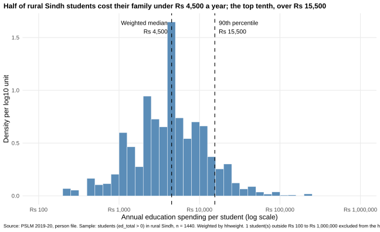
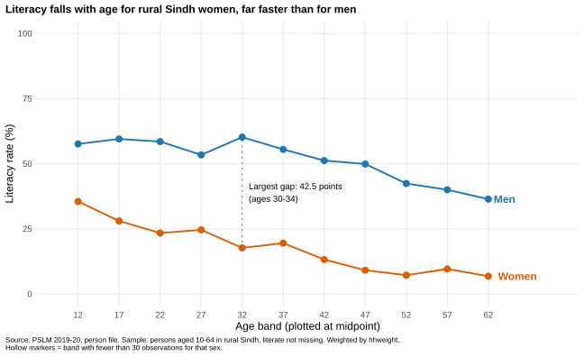
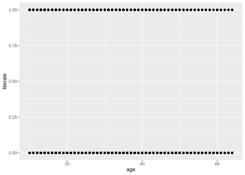

# ECO346 Assignment 1: FA24-BED-102

**Variant 2: Sindh, rural** (prov_code = 3, urban_rural = 1).
Data: PSLM 2019-20 person file, weighted by hhweight.

## How to reproduce
Run the scripts in `scripts/` in order from the repository root: `01_default.R`, `02_histogram.R`, `03_literacy.R` (R), then `04_second_language.py` (Python). Each reads the local CSVs in `data/` and saves SVG figures in `figures/`.

## Figure 1: Distribution of education spending (Q2)

Students: 1,440. Weighted median: Rs 4,500. Unweighted median: Rs 4,295. Weighted 10th percentile: Rs 1,000. Weighted 90th percentile: Rs 15,500. Ratio p90/p10: 15.50. Excluded from the histogram: 1.

Half of rural Sindh students cost their family under Rs 4,500 a year, but the top tenth cost over Rs 15,500, which is 15.5 times the 10th percentile. The weighted median is slightly above the unweighted one, so the survey weights give a little more influence to students whose spending is higher.

## Figure 2: Literacy by age band (Q3)

| Age band | Men: n | Men: literacy % | Women: n | Women: literacy % |
|---|---|---|---|---|
| 10-14 | 718 | 57.6 | 529 | 35.5 |
| 15-19 | 548 | 59.5 | 446 | 28.0 |
| 20-24 | 422 | 58.5 | 455 | 23.4 |
| 25-29 | 419 | 53.4 | 430 | 24.6 |
| 30-34 | 382 | 60.2 | 399 | 17.7 |
| 35-39 | 391 | 55.5 | 319 | 19.5 |
| 40-44 | 274 | 51.2 | 285 | 13.2 |
| 45-49 | 221 | 49.9 | 198 | 9.1 |
| 50-54 | 208 | 42.4 | 152 | 7.2 |
| 55-59 | 100 | 40.0 | 98 | 9.6 |
| 60-64 | 100 | 36.4 | 77 | 6.8 |

Women aged 15-19: 28.0%. Men aged 15-19: 59.5%. Women aged 55-59: 9.6%. Men aged 55-59: 40.0%. Largest gap: ages 30-34 (42.5 points). No band has fewer than 30 observations.

Interpretation: In rural Sindh, women are less literate than men in every age band. The gap peaks at ages 30-34, at 42.5 points. Younger women are more literate than older women, which suggests schooling has expanded across cohorts, yet young women still trail young men by about 30 points. This is a single cross-section, so it compares different cohorts and does not follow anyone over time. It cannot tell us whether any person's literacy changes with age, or why girls are less schooled.

## Makeover (Q4)
**Default figure:**

**Redesign (Figure 2):**

Default figure: `figures/default.svg`. Redesign: Figure 2.

The default plots 7,171 points that are all 0 or 1, so they overplot into two stripes and show no pattern. I made three changes. First, I plotted conditional means (weighted literacy rate by age band), so the rate is read by position on a common scale, the most accurate perceptual channel. Second, I split women and men into two coloured series with direct labels instead of a legend, which saves ink and eye movement. Third, I removed background and clutter (data-ink) and added a finding title and a caption with source, sample and weighting. The default shows every single year of age and the raw 0/1 values; my redesign hides within-band variation and the number of people behind each point.

## Second language (Q5)
Script: `scripts/04_second_language.py`. Figure: `figures/literacy_by_age_python.svg`. Tables: `figures/band_table_R.csv` and `figures/band_table_python.csv`.

Women aged 15-19: 28.0% in R and 28.0% in Python.

One default that differed was gridlines: ggplot’s minimal theme draws light grid lines, while matplotlib draws none. To make the figures match, I set the Python y-axis to 0-100, the x-axis to 10-70, put ticks at the band midpoints, and removed the top and right borders. The band tables agree to one decimal; women aged 15-19 are 28.0% in both.
